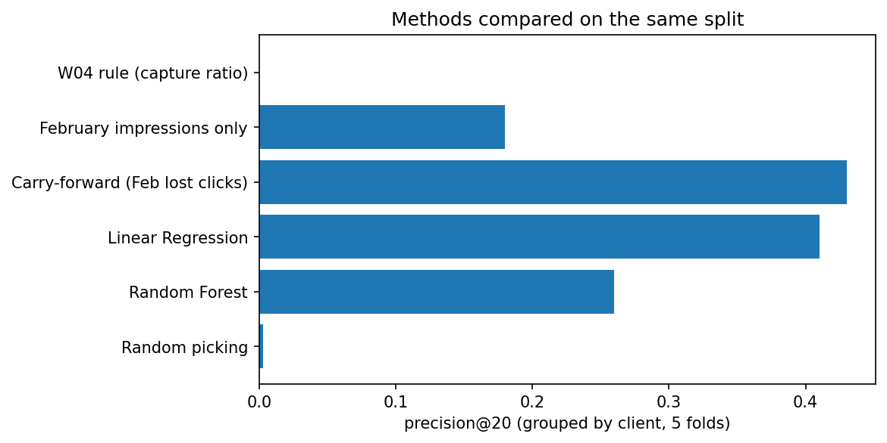
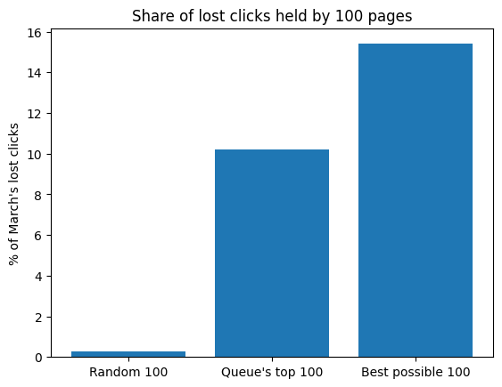
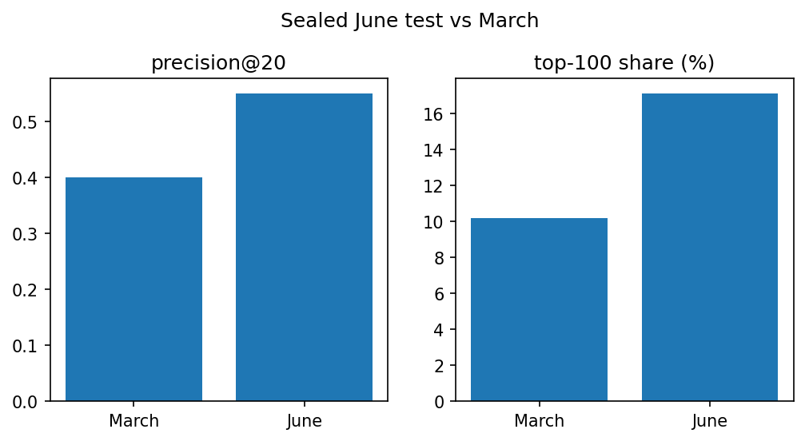
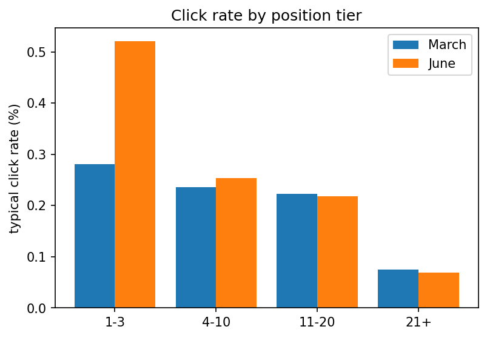

# Which Pages Should a Reviewer Look at First? A Click-Gap Review Queue for Keyword Articles

- **Author:** Axel Yoel Chandra
- **Lane:** Lane 4 — CTR / Engagement Opportunity Scoring
- **Repo:** https://github.com/AxelYoel/FlyRank-AI-Internship---Axel-Yoel-Chandra
- **Date:** 15 October, 2026

**Access note.** Re-running the queries needs approved access to the FlyRank dataset. All results are shown on this page.

---

## 0. Abstract

Content teams cannot manually review tens of thousands of articles. Using Google Search Console data from 43 clients, I evaluated methods to identify articles earning fewer search clicks than expected for their ranking position (“lost clicks”). Page details alone showed no skill, and adding last month’s traffic gave models real skill, but a simple carry-forward rule that ranked pages by the previous month’s lost clicks performed as well as Linear Regression (precision@20 of 0.43 vs. 0.41, against 0.003 for random picking). Applied as a monthly review queue, this rule’s top 100 pages captured about 10% of all lost clicks in March 2026 (15% is the best possible) and about 17% in a one-time sealed test on June (24% best possible; precision@20 of 0.55). With only two months of observational data, one position tier’s click rate shifting by about 85%, and no evidence that editing a page recovers clicks, I recommend it as a simple decision-support heuristic for prioritizing editorial review.

---

## 1. Problem framing

**Decision supported.** A content strategist or SEO analyst has to decide, once a month, which pages to open and review first. A portfolio of this size (38,726 scored pages) is too large to review by hand.

**Unit of analysis.** One row is one page (`content_hash_id`), summarized over one calendar month.

**Output.** A ranked list of pages. The score is *February lost clicks*: (typical click rate for the page's February position tier × February impressions) − February clicks. A bigger gap ranks higher.

**Action a human takes.** The reviewer opens each queued page and works through a short checklist (Section 7). The queue says where to look first. It does not say what is wrong or what change would work.

**Cost of a wrong call.** A false alarm costs reviewer time. I assume 30 minutes per page, which is a guess and not measured, so reviewing 20 pages is about 10 hours and 100 pages about 50 hours. A miss means a page that deserved attention was not looked at. The larger risk is someone reading "lost clicks" as "recoverable clicks" or as proof of a cause. This work supports neither.

**Why data helps here at all.** Human attention is the scarce resource, and a ranking is a cheap way to spend it. In this project, however, a very simple rule did about as well as a model (Section 5), so "ML helps" is only partly true here, and I say so.

**How I got here.** I started in Lane 1 (signal analysis) on the 30,000-row starter file. Grouping median CTR by position tier gave the one pattern that held up across well-populated groups (from 0.22% for page 1 down to 0.00% for the deepest pages; the small top-3 group of 560 pages sat slightly below page 1 at 0.18%), while word count, freshness and content type looked large at first but came from very small groups (observed). That pointed to Lane 4, which formalizes "expected CTR for a position tier."

---

## 2. Data safety

**Source.** FlyRank ML Internship warehouse (Hugging Face dataset, DuckDB over Parquet). The course materials describe the warehouse as roughly 79 million rows (also cited in W01); I did not count this myself. March 2026 alone has 9,841,378 daily rows.

**Tables and windows used**

| Table | Used for | Window |
|---|---|---|
| `fact_content_daily_performance` | clicks, impressions, average position | March 2026 (target month), February 2026 (prior month) |
| `dim_content` | search volume, competition level, word count, update date, created date, content type, client id | static |
| `dim_clients` | checking when a client's search data starts | static |
| `fact_content_daily_performance` (sealed test) | May 2026 builds the queue; June 2026 scores it, queried once | May and June 2026 |

**Population.** March pages with a real position and at least 50 impressions: 114,447 pages (of 175,304 with a real position). The scored slice is keyword articles with search volume of 20 or more: **38,726 pages from 43 clients.** The queue ranks the 33,950 of those that have usable February data (36 clients).

**What I excluded, and why**

- **`fact_content_query_90d`**: its fixed window (April 2 to June 30) overlaps the held-back June month, and its 90-day sums include clicks from after any decision date.
- **June 2026**: not used for any design choice. It was queried once, in the sealed test in Section 5, after everything else was frozen.
- **Rows with `gsc_avg_position = 0`**: treated as "no real position," not rank 1. The 0 bucket's CTR (0.25%) sits below the 1–3 and 4–10 buckets, and 163,189 March rows are affected.
- **Pages under 50 impressions**: the click rate is too noisy. In the starter file, noise (spread of CTR) dropped sharply at 50+ impressions.
- **Content types other than keyword articles, and search volume under 20**: comparison articles are almost all zero search volume, feedly articles have no search volume at all, and for keyword articles with search volume under 20 the clicks-to-volume ratio reached implausible values (above 50).
- **`ga4_sessions`, `pageviews`, `users`, `optimization_eligible_date`**: excluded for row-level mismatches, circularity, and an unresolved date ambiguity.
- **Starter file label-derived fields (`trend_direction`, `trend_pct`)**: not used as features.

**Leakage risks I considered**

- **Label ingredients.** `lost_clicks = expected_clicks − clicks`. Adding `expected_clicks` and `clicks` as features lifted R² from 0.0072 to 1.0000 in W03, and to R² and precision@20 of 1.0 in every fold in W06. Both are excluded from the final features.
- **Update date timing.** `days_since_update` was first measured to March 31, inside the month being predicted. I rebuilt it as of February 28. 63 of 5,132 pages changed and the scores were identical, so the fixed version is the one I keep.
- **Pseudonymous IDs.** `content_hash_id` is a grouping key only. `client_hash_id` is used only to build cross-validation folds, never as a feature.
- **Snapshot fields.** `search_volume` and `competition_level` come from a table with no date of its own. I cannot rule out a small timing risk (disclosed again in Section 6).

**Public safety.** No client names, URLs or private queries appear in this paper. It reports no individual page or client identifiers.

---

## 3. Baseline

**The rule (from W04).** For keyword articles with search volume of 20 or more, `capture_ratio = clicks / search_volume`. A lower ratio means a higher priority. The action label was `review_for_recoverable_opportunity`.

**Why I built it first.** It is transparent, a manager can read it in one sentence, and it needs no training.

**Why it is not a fair forecast baseline.** It uses March clicks, so it is not a prediction made before March. It also produced a weak ranking: 17,400 of the 38,726 scored pages tied at a ratio of exactly 0 (about 45%), and the top 20 were all zero-click pages that differed only in search volume.

**Its numbers (same split and metric as the model)**

| | 5 folds | 10 folds |
|---|---|---|
| W04 rule, precision@20 | 0.000 | 0.000 |
| Random picking, precision@20 | 0.0027 | 0.0077 |

Because that rule is so weak, "the model beats the baseline" would be a meaningless test. I added two stronger, no-model references that use only information known before March: **rank by February impressions** and **carry forward February's lost clicks** (rank by last month's gap). Section 5 compares all of them.

---

## 4. Model / analysis

**Task.** Predict each page's March `lost_clicks`, rank pages by the prediction, and review from the top.

**Target, in one sentence.** `lost_clicks` = (impression-weighted median CTR of the page's position tier × the page's impressions) − the page's clicks, with four tiers (positions 1–3, 4–10, 11–20, 21+) and tier rates of 0.2811%, 0.2353%, 0.2226% and 0.0748%.

**Models.** Linear Regression (readable, tried first) and Random Forest (300 trees, seed 42, a stronger candidate).

**Final feature list**

- `search_volume`
- `word_count` plus a `has_word_count` missing-value flag
- `days_since_update` (as of February 28) plus an `updated_before_feb28` flag
- `competition_level` (dummy columns)
- `feb_impressions`, `feb_clicks`, and a `has_feb_data` flag

**Left out on purpose.** March `clicks`, March `impressions`, `expected_clicks`, `expected_ctr`, March average position, `client_hash_id`, and `content_type` (constant inside the scored slice). The update-date and word-count features carry missing-value flags, because 82.6% of update dates are missing and word-count gaps depend on content type.

**Two stages.** Stage 1 used page details only. Stage 2 added February traffic to test whether missing traffic was the problem.

**Final choice.** I use the carry-forward rule as the queue, not a trained model. It is simpler, needs no training or split, and tied the best model (Section 5).

---

## 5. Evaluation

**Split.** Grouped k-fold by client, with k = 5 and k = 10, over 43 clients and 38,726 pages, seed 42. A random split could put the same client's pages in both training and test. The data is very uneven: the top 5 clients hold about 77% of the scored rows, so the biggest clients each end up alone in a test fold. Folds 0 and 1 are identical in k = 5 and k = 10, so the two k values are not independent evidence. March is the target month, February is a feature, and June is held back for the one-time sealed test below.

**Metrics.** precision@20 (how many of the true top 20 pages in a fold the method also puts in its top 20), the share of lost clicks held by the top 100 pages, and R² (models only, since the rules do not predict a click count). The honest base rate for precision@20 is random picking, about 20 divided by the fold size (0.0027 for k = 5). A "majority class" base rate does not apply to a ranking task.

### Stage 1: page details only

| | 5 folds | 10 folds |
|---|---|---|
| Linear Regression R² (mean) | −0.050 | −0.049 |
| Random Forest R² (mean) | −2.65 | −2.93 |
| precision@20, Linear Regression / Random Forest | 0.000 / 0.010 | 0.000 / 0.010 |

Page details alone gave no measured skill (measured).

### Stage 2: with February traffic (the main result)

| Method | precision@20, 5 folds | precision@20, 10 folds | share of lost clicks in top 100, 5 folds | share in top 100, 10 folds |
|---|---|---|---|---|
| W04 rule (capture ratio) | 0.000 | 0.000 | 0.006 | 0.026 |
| February impressions only (no model) | 0.180 | 0.220 | 0.134 | 0.228 |
| **Carry-forward: February lost clicks (no model)** | **0.430** (0.25–0.55) | **0.390** (0.10–0.70) | **0.224** | **0.272** |
| Linear Regression | 0.410 (0.25–0.60) | 0.395 (0.05–0.70) | 0.213 | 0.276 |
| Random Forest | 0.260 (0.15–0.35) | 0.250 (0.05–0.50) | 0.177 | 0.241 |
| Random picking (base rate) | 0.0027 | 0.0077 | 0.013 | 0.039 |

R² for the models: Linear Regression 0.61 (fold range 0.36 to 0.87) at k = 5 and 0.45 (0.07 to 0.96) at k = 10. Random Forest 0.38 (0.04 to 0.74) and 0.21 (−0.67 to 0.90). Scores vary widely by fold because the folds are dominated by a few large clients.

*(Ranges in brackets are the minimum and maximum across folds.)*



*Figure 1. precision@20 by method, grouped by client, 5 folds. Random picking is about 0.003.*

### Does the model beat the simple rule?

I set a bar before testing: a model should beat the rule consistently, catch what the rule misses, and work where the rule cannot be applied.

1. **Beats the rule consistently:** no. It ties the carry-forward rule (0.41 vs 0.43 at 5 folds, 0.395 vs 0.39 at 10). Where the two lists disagree, the rule's extra picks held more true lost clicks in 4 of 5 folds (small differences, one month).
2. **Catches what the rule misses:** not shown. In the cases I checked, both made the same errors (3 cases each, a small sample).
3. **Works where the rule cannot be applied** (about 12.3% of pages have no February data): untested.

The two methods mostly agree: the Spearman correlation between the Linear Regression prediction and February lost clicks is 0.81 to 0.94 across folds, and 60 to 91 of their top 100 pages are shared.

### Same model, honest split (W06)

| (Linear Regression, same features) | random split | grouped by client |
|---|---|---|
| R² | 0.616 | 0.613 |
| precision@20 | 0.41 | 0.41 |
| share of lost clicks in top 100 | 0.227 | 0.213 |

I expected the random split to score higher. R² and precision@20 were essentially equal, and two earlier runs gave random-split R² of 0.608 and 0.622, so differences of about 0.01 are within run-to-run noise. Share in the top 100 was a little higher under the random split in all three runs. My best explanation, not proven: the model leans on each page's own February traffic, which works the same way for every client, and client identity is not a feature. This does not show the model is leak-free. A grouped split only blocks one kind of leak, and I used one seed and one month.

### Leakage and validity checks (W06)

| Check | Result |
|---|---|
| Deliberate leak (add `expected_clicks` and March clicks) | R² and precision@20 reach 1.0 in every fold, so my setup can detect an obvious leak. Share in the top 100 reaches 0.339, the ceiling for that metric. My honest 0.213 is about 63% of it. |
| Update date rebuilt as of Feb 28 | 63 of 5,132 pages changed; scores identical |
| Benchmark rates rebuilt from training clients only | R² 0.613 → 0.603, precision@20 0.41 → 0.40, share in top 100 0.213 → 0.212. A small leak, mostly in the two giant-client folds. |
| Population filter | 3,125 of 32,537 February-active pages (9.6%) never reached the March table, mostly low-traffic ones. I do not know whether this makes scores look better or worse. |

### The queue itself (W07)

Using all 33,950 ranked pages and the month's true outcome:

| | share of March's lost clicks held by 100 pages |
|---|---|
| 100 random pages (expected) | about 0.3% (0.0029) |
| **The queue's top 100** | **10.2%** |
| Best possible 100 (chosen with hindsight) | 15.4% |

Precision@20 against that month's true top 20 was 0.40. The queue reaches about two-thirds of the best-possible share (0.102 / 0.154). These shares count only pages that got fewer clicks than expected. **They are not comparable with the share columns above:** the cross-validation numbers are computed inside folds of roughly 1,700 to 11,000 pages, so a fold's top 100 is a much larger slice, and random picking scores 1.3% there instead of 0.3%.



*Figure 2. Share of March's lost clicks held by 100 pages.*

### Sealed June test (W08)

**Design, frozen before June was queried.** Review date May 31, 2026. The queue was built from May data only, with the same four March click rates, the same keyword-article and search-volume filters, and the same 60-day new-page rule. June was queried once and scored with the same March rates. I wrote my prediction into the notebook before running it. The evaluation covers 38,661 pages with at least 50 June impressions: 36,256 ranked, 300 older pages with no May data, 360 new pages, and 1,745 not yet created at the review date.

| | My prediction (range, best guess) | June result | March (W07) |
|---|---|---|---|
| precision@20 | 0.20 to 0.50, best guess 0.35 | **0.55** | 0.40 |
| share of lost clicks in top 100 | 0.06 to 0.11, best guess 0.08 | **0.171** | 0.102 |

I predicted both numbers would land a little below March. Both landed above March and above my ranges. My prediction was wrong in direction, and my reasoning (a method chosen on March would look worse on a new month) was not supported by this one test.

| June, ranked pages | precision@20 | share of lost clicks in top 100 |
|---|---|---|
| The queue (May lost clicks) | 0.55 | 0.171 |
| Rank by May impressions only (no model) | 0.40 | 0.149 |
| Best possible (hindsight) | not computed | 0.240 |
| Random picking (expected) | 0.0006 | 0.0028 |



*Figure 3. The queue in March (W07) and in the sealed June test.*

What I can say (measured, one month):

- The queue beat random picking by a very wide margin.
- It reached about 71% of the best-possible share (0.171 of 0.240), against about 66% in March. The raw share rose partly because the ceiling rose too (0.154 in March, 0.240 in June): June's lost clicks were more concentrated in a few pages.
- Its edge over "rank by May impressions only" is directional. 0.55 against 0.40 is a difference of 3 of 20 pages, and 0.171 against 0.149 is small. The impressions-only reference was much stronger here than in the W05 cross-validation (about 0.18 to 0.22), so I would not claim that the gap idea adds a lot beyond "busy pages."
- A single 0.55 equals the top of the W05 5-fold range (0.25 to 0.55), so it is not evidence that the queue got better.

**Diagnostics, run only after the result was saved.**

| Position tier | March rate | June rate | Change |
|---|---|---|---|
| 1 to 3 | 0.2811% | 0.5204% | **+85%** (over my 25% threshold) |
| 4 to 10 | 0.2353% | 0.2539% | +7.9% |
| 11 to 20 | 0.2226% | 0.2177% | −2.2% |
| 21+ | 0.0748% | 0.0692% | −7.5% |



*Figure 4. Typical click rate by position tier. The rate for positions 1 to 3 moved by about 85%.*

The true top 100 pages had a median June-to-May impressions ratio of 0.95, and only 6% had June impressions of 3 times May or more. The Spearman correlation between May and June lost clicks across ranked pages was 0.489. The precision@20 trigger (0.30 or lower) did not fire, and the older-page share was 0.78% (trigger at 2%).

What this suggests, but I did not test: the queue held up because the top pages' traffic changed little between May and June, which would make June an easier month than March. I also scored June with the March rate for positions 1 to 3, which was too low in June, so the gaps of top-tier pages are measured against a stale rate. I did not check how much that changes the ranking.

### Error analysis

The model and the carry-forward rule use only information from before March. They work when March resembles February, and they fail when a page's traffic changes sharply.

- **Misses.** 20 true top-20 pages were ranked below 1,000 by the model. Of the three top-ranked misses I examined (true ranks 1, 3 and 4), March impressions were about 5× to 49× February's.
- **False alarms.** 11 model top-20 pages truly ranked below 1,000. Of three examined, one fell from 51,000 February impressions to 2,288 in March. In the other two, impressions were similar but March clicks were higher than February's.
- **Cause: not checked.** A new backlink or a seasonal change are possible explanations, but I have not tested either. Six examined pages is a small sample.

---

## 6. Interpretation

**What the analysis found, in plain words**

1. **Page details barely help.** Search volume, competition level, word count and update date carry almost no information about lost clicks once February traffic is known (permutation importance of about 0). February clicks and February impressions dominate (measured, one month).
2. **A last-month number is hard to beat.** Linear Regression mostly reproduces February's own lost clicks, which is why a no-model rule ties it. Random Forest was behind Linear Regression on every measure here.
3. **Position tiers are close together in this data.** Expected click rates for positions 1–3, 4–10 and 11–20 are nearly equal (0.28%, 0.24%, 0.22%), and only 21+ is clearly lower (0.07%). So the queue mostly flags pages with many impressions and few clicks. Pages with zero or very few clicks also pull the typical (median) rate below the pooled rate.
4. **The top tier's click rate moved in June.** In the sealed test the typical click rate for positions 1 to 3 was about 85% higher than the March value, past my 25% monitoring threshold, while the other three tiers moved by less than 10%. The queue still scored well, so the stale rate did not break the ranking in this test (observed, one month). Why the rate moved is not known.

**Negative and surprising results**

- **Decay and refresh.** I expected old, un-updated pages to lose more clicks. The data did not show a clear pattern: the staleness check was mixed (the 91–365 day group had only 208 pages), days since update had near-zero weight in the model, and rebuilding it as of Feb 28 changed 63 of 5,132 pages with identical scores. This queue therefore makes no refresh recommendation. A well-understood "no clear pattern" is a valid result.
- **The first rule scored at chance.** My W04 rule (precision@20 of 0.000 against a random 0.0027) turned out to rank pages with zero clicks by search volume, which is a different thing from lost clicks.
- **In the starter file**, position tier was the one signal that held up when small groups were set aside, while word count, freshness and content type headline gaps vanished once thin groups were excluded (observed, 30,000-row sample).

**Content archetypes were not built.** I chose to stay on one question, which pages to review first. Grouping pages by type is future work, not a result.

### Limitations & honest framing

- **Two months.** The main comparison uses March 2026 (February as the prior month), and one forward test uses June 2026 (May as the prior month). precision@20 for the carry-forward rule ranged from 0.25 to 0.55 across 5 folds and from 0.10 to 0.70 across 10 folds, so the single June value of 0.55 sits at the top of that range.
- **Observational, not causal.** Nothing here shows that editing a page would raise its clicks. "Lost clicks" means fewer clicks than the typical page at that position. It does not mean recoverable clicks.
- **A small leak remains in the queue.** The tier click rates come from March data. I tested this for the model in W06 (small effect) but not for the carry-forward rule itself. The sealed June test does not have this leak, because its rates predate the May review date, but one of those rates had gone stale (Section 5).
- **Not a true forecast baseline.** The W04 rule uses March clicks.
- **Uneven clients.** The top 5 clients hold about 77% of the 38,726 scored rows and about 82% of the 33,950 ranked pages, so results mostly reflect a few large clients. Per-client results were not checked.
- **Snapshot fields.** Search volume and competition level have no date of their own. Search volume is also a topic-level value, so several pages can share one number.
- **Population.** The scores describe keyword articles with search volume of at least 20 and at least 50 impressions in March. They may not hold for other pages, content types, new clients or other months. 7 clients (121 pages) have no ranked pages because their search data starts between Feb 19 and Mar 27.
- **The sealed test is small.** It is one month, scored with the March click rates, over pages with at least 50 June impressions (a filter a real user could not apply in advance, as in W06; I do not know which way it pushes the score). I did not re-score June with June's own rates. The queue fingerprint was printed before June was queried.
- **Assumptions that are guesses.** The 30 minutes per page, the 60-day new-page cutoff, the 20% review share for older unranked pages and the monitoring thresholds are starting guesses.

### Claims register

| Claim | Label |
|---|---|
| Page-detail features alone have no skill (R² ≈ −0.05) | measured |
| Carry-forward ties Linear Regression and beats the other tested methods | measured, one month |
| The queue's top 100 holds about 10% of March's lost clicks | measured, one month |
| In the sealed June test the top 100 held about 17% (about 71% of the best possible) | measured, one month |
| The queue beat ranking by May impressions alone in June | directional (3 of 20 pages; 0.171 vs 0.149) |
| The click rate for positions 1 to 3 rose about 85% from March to June | observed |
| My prediction that June would score below March | wrong; both numbers came in above |
| Misses and false alarms follow sharp traffic changes | observed, 6 cases |
| Why those traffic changes happened | not known |
| Editing a queued page will gain clicks | not claimed |
| The queue should guide human review order | decision-support |

---

## 7. Ranked recommendations

**How a FlyRank editor would use this tomorrow.** Once a month, build the queue from the finished month's data, then review pages from the top. Reason code `feb_gap_vs_tier_rate`, action `review_low_clicks_for_position`. The label means "this page got fewer clicks than typical for its position."

**Ranked actions**

1. **Review the ranked queue in order.** The 33,950 ranked pages are ordered by February lost clicks, highest first.
2. **Answer six yes/no questions on every page before changing anything:**
   1. *Technical problem?* Is the page indexed and crawled? Was its URL or structure recently changed? If so, fix that first.
   2. *Intent mismatch?* Does the page match what searchers want? If not, record it as a possible reason to test, not as the cause.
   3. *Sharp traffic change since February?* The rank may be unreliable, so note it and re-check next month.
   4. *Crossed a position tier?* Moving into or out of 21+ changes the expected rate about three to four times. Recompute the gap with the page's current tier and lower its priority if the gap disappears.
   5. *No February data?* See the next action.
   6. *Competing pages?* Pages sharing a search volume may compete for the same topic, so review them together.
3. **Handle unranked pages separately** (reason code `no_prior_month_data`). New pages (created under 60 days before the review date, 1,674 pages) are re-checked next month. Older pages with no February data (463 pages) get about 20% of review time, highest search volume first. No February data does not mean no problem.
4. **Make no refresh recommendation.** The data did not support one.

**Never automate:** publishing edits, deleting or merging pages, telling a client what a change will achieve ("will increase", "recovers clicks"), or using the queue on other content types or new clients without re-checking it.

**Monitoring.** Run each month on the new data. The queue is paused first if a trigger fires. A person checks which trigger fired, the reviewer is told, and the queue resumes only after a person approves it. Nothing retrains or changes automatically.

| Watch this | Now | Worry if |
|---|---|---|
| precision@20 against that month's true top 20 | 0.40 | 0.30 or lower for 3 months in a row |
| Older-page share (60-day cutoff) | 1.2% (463 of 38,726) | reaches 2% |
| Typical click rate per position tier | 0.2811%, 0.2353%, 0.2226%, 0.0748% (March) | any rate differs by more than 25% |

**What the June check showed.** The rate trigger fired: the positions 1 to 3 rate was about 85% above its March value. The precision@20 trigger and the older-page trigger did not. Under my own rule, the queue would be paused and the four rates recomputed before the next review, even though the queue scored well in June. That is the cautious option working as designed.

The 25% threshold comes from scaling all four rates together: a 10% change kept 93 to 94 of the top 100 pages and a 25% change kept 81 to 85. One rate moving alone was not tested. The cutoff choice (60 days) comes from comparing older-page lists of 1,272, 783 and 463 pages at 20, 30 and 60 days, and the data cannot say how long a page needs to settle.

**Confidence and limits.** I am moderately confident that this ordering is better than random and close to as good as the models I tested (measured, two months, one of them a sealed forward test). I am not confident in how it performs in other months, for other content types, or for any single client. I have no evidence it increases clicks. Treat it as decision support, not as a rule or proof.

---

## 8. Reproducibility

**Access.** The notebooks read from the Hugging Face dataset `FlyRank/internship-warehouse` and need an approved access token stored as a Colab secret named `HF_token`. Someone without dataset access can read the code and the committed outputs but cannot re-run the queries.

**Re-run from a fresh clone (Google Colab)**

1. Clone `https://github.com/AxelYoel/FlyRank-AI-Internship---Axel-Yoel-Chandra`.
2. Add the `HF_token` secret in Colab.
3. Run, in order, from `work/notebooks/`: `w03_data_contract.ipynb` → `w04_baseline_score.ipynb` → `w05_model.ipynb` → `w06_validation_audit.ipynb` → `w07_action_playbook.ipynb`, then `capstone.ipynb`. `w08_sealed_june.ipynb` is a one-time test; its result is the committed notebook and file below, and it is not meant to be run again to get a new result.
4. `w07_action_playbook.ipynb` writes `work/outputs/action_queue.csv` (kept out of git by design), `work/outputs/queue_metrics.json`, and `work/figures/queue_value_top100.png`.

**Files committed to the repo, and how they were made.** The notebooks wrote their output files to the temporary Colab disk, and those originals were not saved. I committed copies instead, and the paper's numbers trace back to the executed notebooks and their saved cell outputs.

| File | How it was made |
|---|---|
| `work/outputs/sealed_june_metrics.json` | Rebuilt by hand from the saved cell outputs of the single executed W08 run. It says so in its first field. No June query was re-run. |
| `work/outputs/queue_metrics.json` | Rebuilt by hand from the saved cell outputs of the executed W07 notebook. It says so in its first field. W07 was not re-run for it. |
| `work/figures/queue_value_top100.png` | Redrawn with the W07 plotting code from three values in W07's output (0.0029, 0.102, 0.154). |
| `work/figures/method_comparison.png`, `sealed_june_vs_march.png`, `click_rate_drift.png` | Drawn by `capstone.ipynb` (Section 7) from the numbers in this paper. |
| `work/outputs/action_queue.csv` | Not committed, by design. W07 regenerates it. |

The rebuilt files are not machine-written originals. A reader who wants the originals can re-run W07, which is not sealed.

**Seeds.** 42 for the random split and the Random Forest.

**Environment.** scikit-learn 1.6.1, pandas 2.2.3, numpy 2.1.3. DuckDB is installed in each notebook with `%pip -q install duckdb`.

**Sealed evaluation.** One was run, once: `work/notebooks/w08_sealed_june.ipynb` builds the May queue and the June scoring frame. Its cells were executed once, in order, and the committed notebook keeps their saved outputs, which are the primary record. `work/outputs/sealed_june_metrics.json` holds the same metrics, the click rates and new-page cutoff used, a fingerprint of the frozen May top 500, and the prediction I wrote before the run (it is a rebuilt copy, as the table above says). June 2026 was not used to build the label, choose features, set filters, or compare models before that test.

---

## 9. Acknowledgments & data credit

Built on the [FlyRank ML Internship dataset](https://flyrank.ai). Thank you to FlyRank for the data access and the structured curriculum.

---


```python

```
